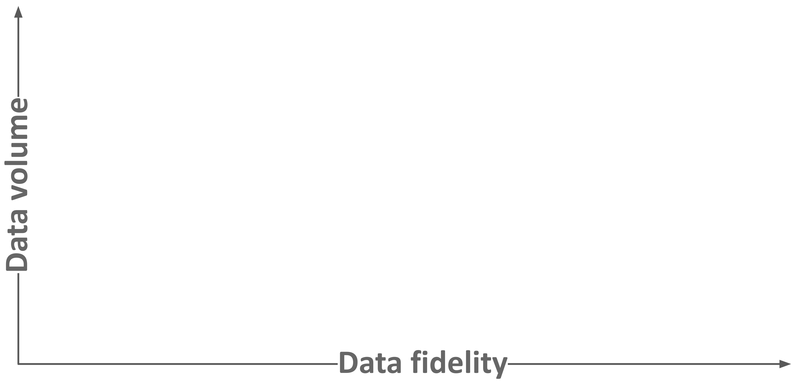
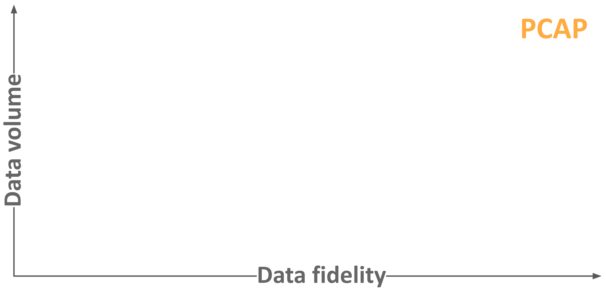
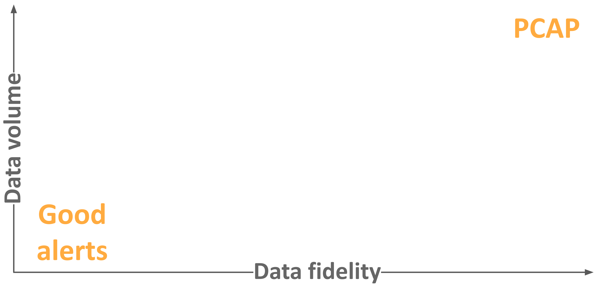
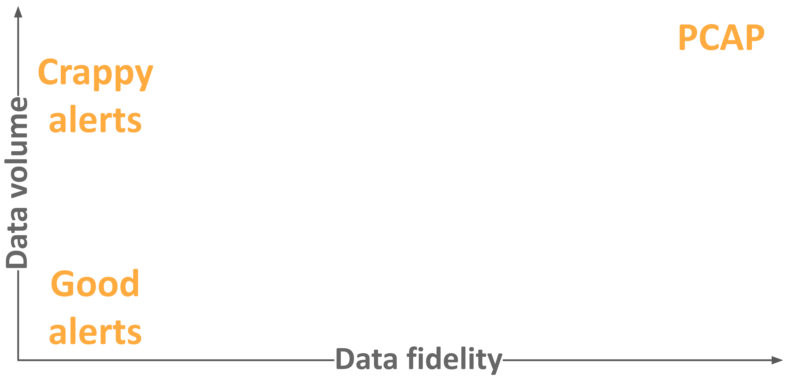
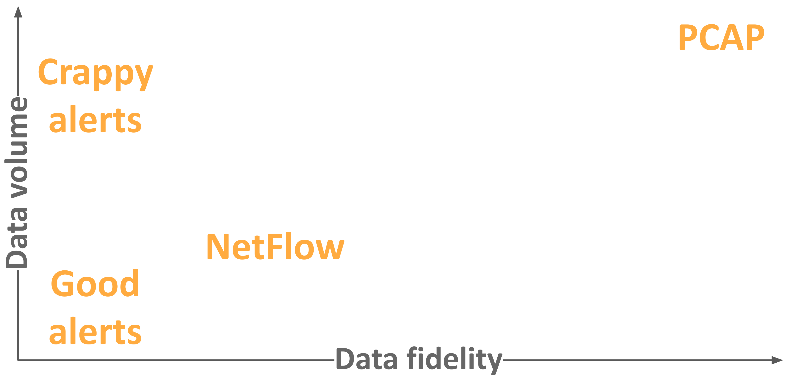
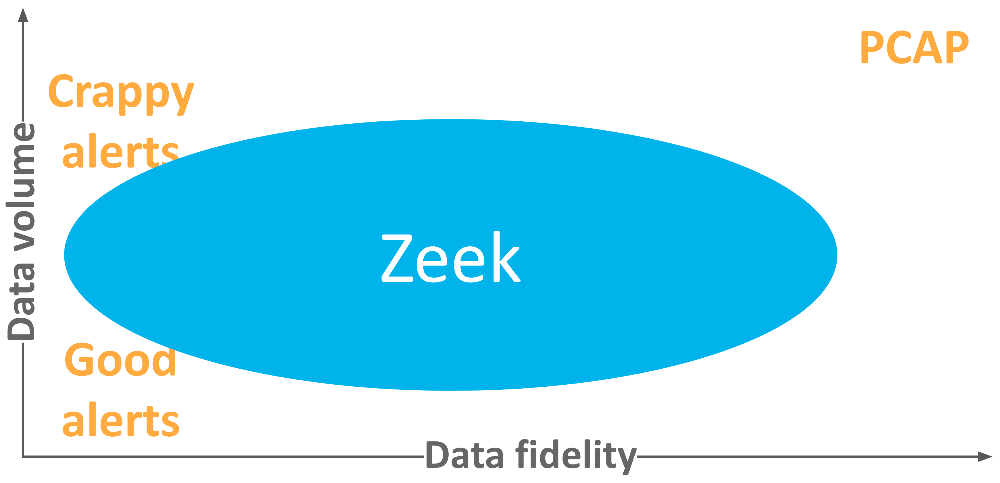
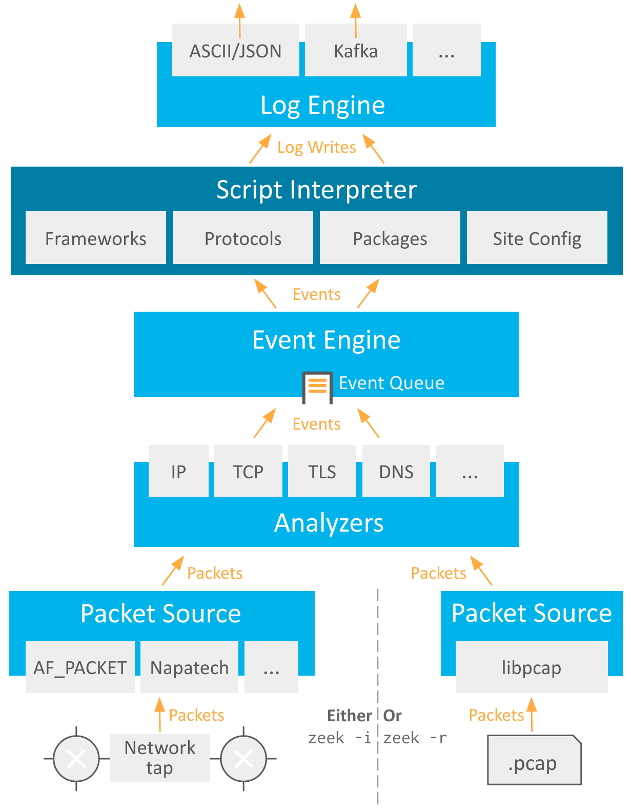
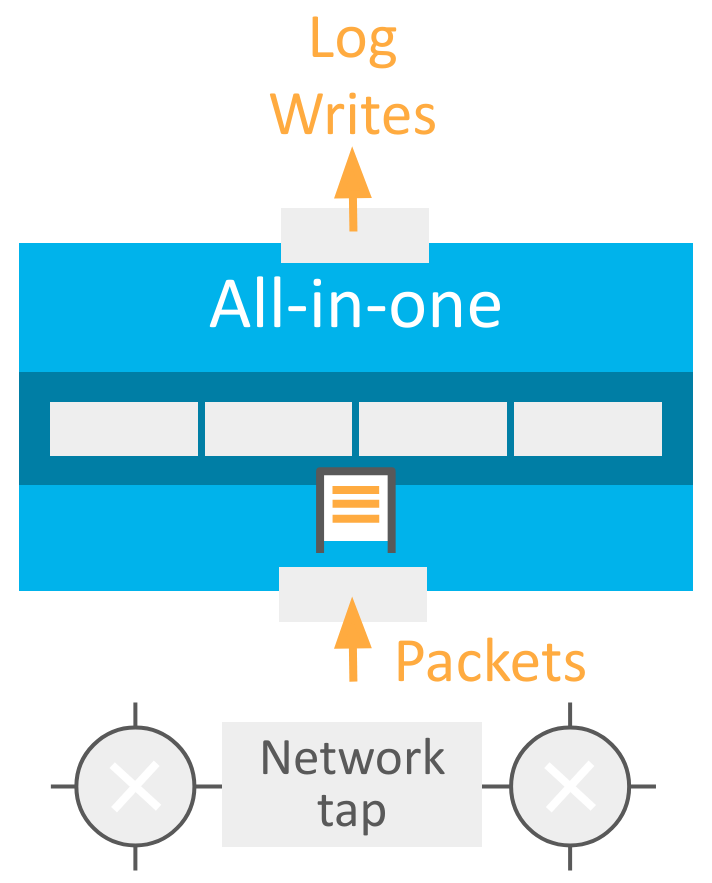
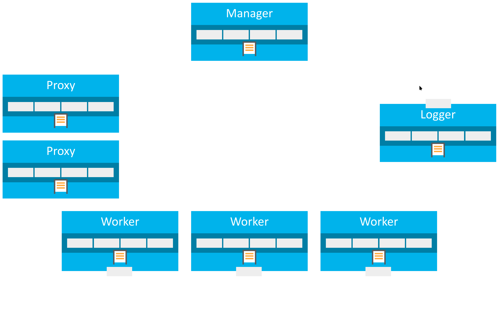
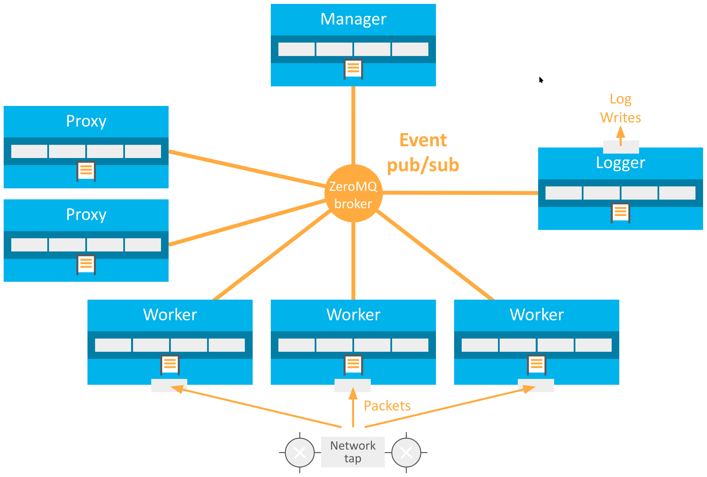

<!-- _class: lead -->


# Introduction to Zeek

## A Zeek training

*Nullcon Berlin, 2026* <!-- rumdl-disable-line MD036 -->

---

# About us

<div class="columns">
<div class="columns-left">

## Benjamin Bannier

Zeek and Spicy maintainer at Corelight

Programming languages, distributed systems, and developer tooling

</div>
<div class="columns-right">

## Christian Kreibich

Zeek project tech lead

25+ years of Zeek experience

An engineer at Corelight

Recovering academic

</div>
</div>

---

# Agenda

- Zeek's role on your network
- Using Zeek at the command line
- Extending Zeek via its package manager
- Running Zeek clusters

---

# Why Zeek?

Incident response, threat hunting, performance monitoring, traffic analysis,
audits, and policy compliance checks all require one thing:

<center>

## Good network data

</center>

Zeek gives you "system logs for your network": rich, transactional data that
collect evidence for later analysis. A network flight recorder!

---



---



---



---



---



---



---

# Zeek logs are **network evidence**

Zeek's primary output is **logs**. They capture the activity on your network,
across the protocol stack.

Zeek logs **don't judge**.

Zeek logs are **extremely adaptable** to your site's needs --- the
sweet-spot between full packet capture, Netflow, and alert logs.

---

# Zeek is **three things**

- **A DPI engine:** in-depth parsing of every packet. The parsing creates *events*.

- **A distributed event-based system:** topic-based publish/subscribe
  *communication* of these events across Zeek.

- **A scripting language:** a domain-specific language that *handles* these events.

---



---

# Examples of Zeek events

<style scoped>pre { font-size: 80%; }</style>

```zeek
event connection_established(c: connection) {
    print fmt("Established connection %s", c$uid);
}

event connection_state_remove(c: connection) {
    print fmt("Connection %s is done", c$uid);
}

event ssl_server_hello(c: connection, version: count,
                       record_version: count, possible_ts: time,
                       server_random: string, session_id: string,
                       cipher: count, comp_method: count) {
    print fmt("Server hello on TLS connection %s", c$uid);
}
```

---

# Zeek ships with a lot of features

- Around 600 types of events
- Some 130 [packet](https://docs.zeek.org/en/current/reference/zeekscript/packet-analyzers.html),
  [protocol](https://docs.zeek.org/en/current/reference/zeekscript/proto-analyzers.html), and
  [file](https://docs.zeek.org/en/current/reference/zeekscript/file-analyzers.html) analyzers
- [75 types of logs](https://docs.zeek.org/en/current/reference/zeekscript/log-files.html)
  for protocols, detections, and behaviors

It's also extremely extensible via scripts, plugins, and packages. More on this
later!

---

# Let's get started

<style scoped>p { font-size: 80%; }</style>

Grab the latest Zeek Docker image and run it:

```shell
docker run -it --name zeek-training 'zeek/zeek'
```

In the container, clone our training repository and cd into it.

```console
# git clone --depth 1 https://github.com/zeek/zeek-training.git /opt/zeek-training
# cd /opt/zeek-training/
```

Run the local setup script to set up additional resources:

```console
# ./setup.sh intro-to-zeek
```

---

# Let's get started (continued)

<style scoped>p { font-size: 80%; }</style>

There's a scratch space for you to work in. Go there:

```console
root@zeek-tutorial:/opt/zeek-training # cd Intro-to-Zeek/scratch
```

**NOTE:** From now on we'll just show `#` for the container prompt, assuming
you're working in `scratch`. You can always wipe and recreate that directory.

Do a quick check in the container that Zeek works:

```console
# zeek --version
```

---

# Let's get started (continued) <!-- rumdl-disable-line MD024 -->

<style scoped>p { font-size: 80%; }</style>

To keep a Docker image of your container, run this outside of it:

```shell
docker commit zeek-training zeek-training
```

For multiple shells in the container, either use `tmux` or launch additional
shells in the container:

```shell
docker exec -it zeek-training bash
```

---

<!-- _class: chapter -->
# Command-line Zeek

---

<!-- _class: smaller -->

# Processing pcaps

Let's run a pcap file (pre-recorded network packets) through Zeek:

```console
# zeek -r ../traces/quickstart.pcap
```

This produced a few logs:

```console
# ls -l
total 20
-rw-r--r--. 1 root root  763 Oct 21 00:05 conn.log
-rw-r--r--. 1 root root  888 Oct 21 00:05 files.log
-rw-r--r--. 1 root root 1081 Oct 21 00:05 http.log
-rw-r--r--. 1 root root  278 Oct 21 00:05 packet_filter.log
-rw-r--r--. 1 root root  396 Oct 21 00:05 weird.log
```

<div class="exercise">

Exercise: take a look at `conn.log`. What do you see? What about `http.log`?

<!-- `conn.log` contains connection-level summaries with protocol and history
info; `http.log` has transactional data. We'll look at these in more detail later,
so the absolute basics are enough here.  -->

</div>

---

# Processing live traffic

Zeek does not wipe logs at startup, so remove them:

```console
# rm -f *.log
```

To process live traffic, specify a network interface via `-i`:

```console
# zeek -C -i eth0
```

The `-C` flag makes Zeek ignore packet checksums, which are frequently invalid
in local traffic capture because the kernel offloads the computation to the NIC.

---

# Processing live traffic (continued)

Now, in another shell, create some network traffic:

```console
# ping -c 5 example.com
```

Stop Zeek via ctrl-c.

<div class="exercise">

Exercise: what logs did the above create? Take a look at `conn.log` --- what
do you see?

<!-- Mainly `dns.log` and `conn.log`, which mentions ICMP for the ping transaction. -->

</div>

---

# Loading custom scripts

You can customize Zeek by loading additional functionality into it. Zeek ships
with a lot of optional functionality, called **policy scripts**. You can also
write your own, of course.

```console
# zeek -r ../traces/http-basic-auth.pcap protocols/http/software.zeek
```

<div class="exercise">

Exercise: run the above with and without the added script. What do you notice in
the logs?

<!-- Zeek generates an additional log, `software.log`, that mentions the browser. -->

</div>

---

# Overriding script values

At startup Zeek loads a lot of script code, including many **tunable
constants**. Adjusting such constants is called a `redef`. You can redef
values at the command line:

```console
# zeek -r ../traces/http-basic-auth.pcap HTTP::default_capture_password=T
```

<div class="exercise">

Exercise: run the above with and without the redef. What do you notice in
`http.log`?

<!-- With the redef, the password column is populated. One way to highlight
the changed column is `git diff --word-diff --no-index ...`.

Also, all the connection UIDs have changed, since the seeds aren't pinned.
You can do so by adding `-G /usr/local/zeek/share/btest/data/random.seed`
or running `zeek -H random.seed`.
-->

</div>

---

<!-- _class: chapter -->
# Working with<br>Zeek logs

---

<!-- _class: smaller -->

# TSV logs and zeek-cut

By default, Zeek writes logs in tab-separated format with header info. It ships
with `zeek-cut`, a tool to filter output from those logs.

```console
# zeek -r ../traces/quickstart.pcap
# cat http.log | zeek-cut -D %s ts id.orig_h id.orig_p id.resp_h
1381844035      192.168.0.4     54317   192.254.189.169
1381844044      192.168.0.4     54318   192.254.189.169
1381844050      192.168.0.4     54337   192.254.189.169
...
```

<div class="exercise">

Exercise: look at `http.log` to understand its columns. Use `zeek-cut` to print
each transaction's flow tuple and URI.

<!-- cat http.log | zeek-cut -D %s ts id.orig_h id.orig_p id.resp_h id.resp_p uri -->

</div>

---

<!-- _class: smaller -->

# JSON logs and jq

You can switch Zeek to logging in JSON. The result is **JSONL**: per-line JSON
objects. Zeek does *not* (by default) dump a single all-in-one JSON log.

```console
# zeek -r ../traces/quickstart.pcap tuning/json-logs
# cat http.log | jq
{
  "ts": 1381844035.271831,
  "uid": "CjfPvV2M1TMv6ilrd2",
  "id.orig_h": "192.168.0.4",
  "id.orig_p": 54317,
  "id.resp_h": "192.254.189.169",
  "id.resp_p": 80,
  ...
```

<div class="exercise">

Exercise: use `jq` to print each transaction's flow tuple.

<!-- Many possibilities, but for example:
     cat http.log | jq 'with_entries(select(.key | startswith("id.")))'
-->

</div>

---

# Meet `conn.log`

Zeek's most central log: a **per-flow summary** of endpoints, protocols,
history, and volumes, with a unique identifier. Many other logs pivot to/from
it.

---

<style scoped>
table {
  font-size: 40%;
}
</style>

<div class="columns">
<div>

```console
zeek -r ../traces/quickstart.pcap tuning/json-logs
cat conn.log | jq
```

</div>
<div>

```json
{
  "ts": 1747147647.668533,
  "uid": "Cy8o9R3BmBbAEo09d9",
  "id.orig_h": "192.168.1.8",
  "id.orig_p": 52917,
  "id.resp_h": "192.0.78.212",
  "id.resp_p": 80,
  "proto": "tcp",
  "service": "http",
  "duration": 0.09847784042358398,
  "orig_bytes": 71,
  "resp_bytes": 377,
  "conn_state": "SF",
  "local_orig": true,
  "local_resp": false,
  "missed_bytes": 0,
  "history": "ShADadFf",
  "orig_pkts": 6,
  "orig_ip_bytes": 335,
  "resp_pkts": 4,
  "resp_ip_bytes": 549,
  "ip_proto": 6
}
...
```

</div>
</div>

---

<style scoped>
table { font-size: 40%; }
p { font-size: 80% }
</style>

<div class="columns">
<div>

```console
zeek -r ../traces/quickstart.pcap tuning/json-logs
cat conn.log | jq
```

| History Letter | Meaning |
| :---:  | :---    |
| s      | a SYN w/o the ACK bit set |
| h      | a SYN+ACK ("handshake") |
| a      | a pure ACK |
| d      | packet with payload ("data") |
| f      | packet with FIN bit set |
| r      | packet with RST bit set |
| c      | packet with a bad checksum (applies to UDP too) |
| g      | a content gap |
| t      | packet with retransmitted payload |
| w      | packet with a zero window advertisement |
| i      | inconsistent packet (e.g. FIN+RST bits set) |
| q      | multi-flag packet (SYN+FIN or SYN+RST bits set) |
| ^      | connection direction was flipped |
| x      | connection analysis partial (e.g. limits exceeded) |

</div>
<div>

```json
{
  "ts": 1747147647.668533,
  "uid": "Cy8o9R3BmBbAEo09d9",
  "id.orig_h": "192.168.1.8",
  "id.orig_p": 52917,
  "id.resp_h": "192.0.78.212",
  "id.resp_p": 80,
  "proto": "tcp",
  "service": "http",
  "duration": 0.09847784042358398,
  "orig_bytes": 71,
  "resp_bytes": 377,
  "conn_state": "SF",
  "local_orig": true,
  "local_resp": false,
  "missed_bytes": 0,
  "history": "ShADadFf", // <- Ooooh!
  "orig_pkts": 6,
  "orig_ip_bytes": 335,
  "resp_pkts": 4,
  "resp_ip_bytes": 549,
  "ip_proto": 6
}
...
```

</div>
</div>

See the [`conn.log` docs](https://docs.zeek.org/en/current/scripts/base/protocols/conn/main.zeek.html#type-Conn::Info) for details.

---

<!-- _class: smaller -->

# Pivoting across logs

The UID is your key for pivoting from log to log.

<div class="columns">
<div>

<!-- The trailing whitespace in the following is intentional,
to get equal font size in both console blocks. -->

```console
# cat http.log | jq '{uid, host, method}'                 
{
  "uid": "Cy8o9R3BmBbAEo09d9",
  "host": "zeek.org",
  "method": "GET"
}
{
  "uid": "CurO9X2iFyU6moTOxg",
  "host": "zeek.org",
  "method": "WEIRD"
}
```

</div>
<div>

```console
# cat conn.log | jq 'select(.uid == "Cy8o9R3BmBbAEo09d9")'
{
  "ts": 1747147647.668533,
  "uid": "Cy8o9R3BmBbAEo09d9",
  "id.orig_h": "192.168.1.8",
  "id.orig_p": 52917,
  "id.resp_h": "192.0.78.212",
  "id.resp_p": 80,
  ...
```

</div>
</div>

The UID is a hashed counter. It's *not* based on the flow tuple.

<div class="exercise">

Exercise: process `quickstart.pcap` into TSV logs. Pick the first `conn.log`
entry. In which logs do you see this connection come up?

<!-- uid=$(cat conn.log | zeek-cut uid | head -1)
     grep $uid *.log

     -> Three: conn.log, http.log, files.log.
-->

</div>

---

<!-- _class: smaller -->

# Some noteworthy logs

`conn.log:` per-flow summaries.

`dns.log:` DNS transactions.

`http.log:` HTTP transactions.

`files.log:` details about files transferred in protocols.

`notice.log:` noteworthy things, sometimes alerts!

`dce-rpc.log, smb.log, ntlm.log, ldap.log:` Windows protocols.

`reporter.log:` Zeek's own system logs: errors, warnings, etc.

`ssl.log:` TLS handshake details (with history!).

`x509.log:` certificates, e.g. for TLS sessions.

---

<!-- _class: chapter -->
# Running Zeek clusters

---

# Basic concepts of a Zeek cluster

In production, Zeek runs as a **cluster of processes**.

Each process (a "node") has a **dedicated responsibility**.

Nodes in the cluster **communicate via pub/sub** on Zeek events.

Running additional nodes, on the same or a different system, allows Zeek
installations to **scale as needed**.

---

# Cluster node types

- **Manager:** one per cluster, central state-keeper and coordination point.

- **Workers:** run the DPI stack, distribute state, and trigger log writes.

- **Proxies:** distributed state-keepers --- a bit like DB shards.

- **Loggers:** one or more per cluster, handle log message output.

---



---



---



---

# Managing a cluster via zeekctl

`zeekctl` is Zeek's traditional cluster manager. You **deploy** cluster
definitions with it, **start** and **stop** nodes, and **check the status** of
your cluster.

It implements ad-hoc, serverless operations on one or more machines, via `ssh`
and `rsync`.

---

<!-- _class: smaller -->

# Let's spin up a cluster

<div class="columns">
<div>

`zeekctl`'s config files reside in `/usr/local/zeek/etc/`.

The `node.cfg` file defines your cluster's topology, and `zeekctl.cfg` controls
various operational settings.

Edit `node.cfg` as shown here (or copy `../misc/zeekctl/node.cfg` 😎).

<!-- TODO: Users might ask "how do I configure zeek here" which we introduced via CLI flags before. Since this cluster always reads `local.zeek` we should probably also properly introduce it there, and briefly mention it here. -->

<div class="exercise">

Exercise: run `zeekctl deploy` and look at the running processes. What do you see?

</div>

</div>
<div>

<style scoped>pre { font-size: 60%; }</style>

```ini
# Example ZeekControl node configuration.

[manager]
type=manager
host=localhost

[proxy-1]
type=proxy
host=localhost

[logger-1]
type=logger
host=localhost

[worker-1]
type=worker
host=localhost
interface=eth0

[worker-2]
type=worker
host=localhost
interface=lo
```

</div>
</div>

---

<!-- _class: smaller -->

# Checking a running cluster

`zeekctl` can give you its own process summary:

```console
# zeekctl status
Name         Type    Host             Status    Pid    Started
logger-1     logger  localhost        running   1488   21 Oct 23:47:00
manager      manager localhost        running   1544   21 Oct 23:47:01
proxy-1      proxy   localhost        running   1607   21 Oct 23:47:03
worker-1     worker  localhost        running   1676   21 Oct 23:47:04
worker-2     worker  localhost        running   1677   21 Oct 23:47:04
```

`zeekctl top` is similar, but provides a resource utilization snapshot.

<div class="exercise">

Exercise: run `zeekctl restart` and look at the above again. What changed?

</div>

---

<!-- _class: smaller -->

# A look at production logs

In production, Zeek builds up logs in real-time in
`/usr/local/zeek/logs/current/`.

Zeek rotates them for archival into `/usr/local/zeek/logs/<date>/` in gzipped
format.

<div class="exercise">

Exercise: create network traffic via `curl`, `ping`, etc. Examine the
logs. Which new ones do you spot?

Stop the cluster via `zeekctl stop` to trigger log finalization.

<!-- Examples include stats.log, stderr/stdout.log, loaded_scripts, etc. -->

</div>

In production, you may choose to export your logs directly into SIEMs, bypassing
your local filesystem. This has pros and cons --- SIEMs provide more
powerful analysis, while files provide long-term robustness.

---

# Managing a cluster via systemd

There's a modern alternative: Zeek 9 added mature support for systemd generators
and a `zeek.conf` config file, so you get things like:

```console
# systemctl start zeek.target
```

```console
# systemctl restart zeek-worker@1
```

For details, refer to [our docs](https://docs.zeek.org/en/master/advanced/deployment/systemd.html).

---

<!-- _class: chapter -->
# Zeek packages

---

# Customizing Zeek via packages

Zeek provides its own **package ecosystem** and package manager, `zkg`. There's
a [package browser](https://github.com/zeek/packages), and
[docs](https://docs.zeek.org/projects/package-manager/en/stable/index.html).

Packages add functionality to Zeek at all levels:

- **Scripts** add enrichments & detections. They modify or add logs.
- **Plugins** contain native code and build at install-time. They
  add packet sources, protocol parsers, log writers, and more.

Almost everything in Zeek is pluggable or extensible.

---

<!-- _class: smaller -->

# The **emudhra-weak-keys** package

This package uses Zeek's
[notice framework](https://docs.zeek.org/en/current/frameworks/notice.html)
to add detections for compromised TSL certificates by the eMudhra intermediate CA.

<div class="exercise">

Exercise: first, install the package.

```console
# zkg install emudhra-weak-keys
```

Run the following pcap in the scratch space:

```console
# zeek -r ../traces/emudhra.pcap tuning/json-logs
```

Repeat with the installed package, and compare your logs:

```console
# zeek -r emudhra.pcap tuning/json-logs emudhra-weak-keys
```

</div>

---

# Some great packages

**Detections:** [emudhra-weak-keys](https://github.com/corelight/emudhra-weak-keys), [php2shell-detect](https://github.com/corelight/php2shell-detect), [redis-rce](https://github.com/zeek/redis-rce)

**Enrichments:** [add-interfaces](https://github.com/J-Gras/add-interfaces), [remote_asn_geoip_conn](https://github.com/amarokinc/remote_asn_geoip_conn)

**Analyzers:** [CISA's ICS parsers](https://github.com/cisagov/ICSNPP), [spicy-nats](https://github.com/evantypanski/spicy-nats)

**Log writers:** [zeek-kafka](https://github.com/SeisoLLC/zeek-kafka), [zeek-log-writer-nats](https://github.com/corelight/zeek-log-writer-nats)

**Miscellaneous:** [logschema](https://github.com/zeek/logschema), [zeek-fuzzy-hashing](https://github.com/J-Gras/zeek-fuzzy-hashing), [zeek-xdp](https://github.com/zeek/zeek-xdp)

---

<!-- _class: chapter -->
# Wrapping up

---

# Next steps

**Start looking at traffic.** Whether [pcaps](https://github.com/zeek/zeek/wiki/Packet-Traces)
or live, you'll learn something immediately. Try your home network!

**Explore Zeek scripting.** Nothing beats writing [your own
scripts](https://docs.zeek.org/en/current/tutorial/scripting/javascript.html)
to unlock Zeek. Check out [try.zeek.org](https://try.zeek.org). You can [use
JavaScript](https://docs.zeek.org/en/current/tutorial/scripting/javascript.html),
too!

**Write a parser.** We offer a [whole language](https://docs.zeek.org/projects/spicy/en/latest/) for
it. It's easier than you think!

---

<!-- _class: chapter -->
# Thanks! <!-- rumdl-disable-line MD026 -->

<style scoped>p { font-size: 80%; }</style>

Official documentation<br>
<https://docs.zeek.org>

Github project<br>
<https://github.com/zeek>

Main repository<br>
<https://github.com/zeek/zeek>

Project wiki<br>
<https://github.com/zeek/zeek/wiki>
